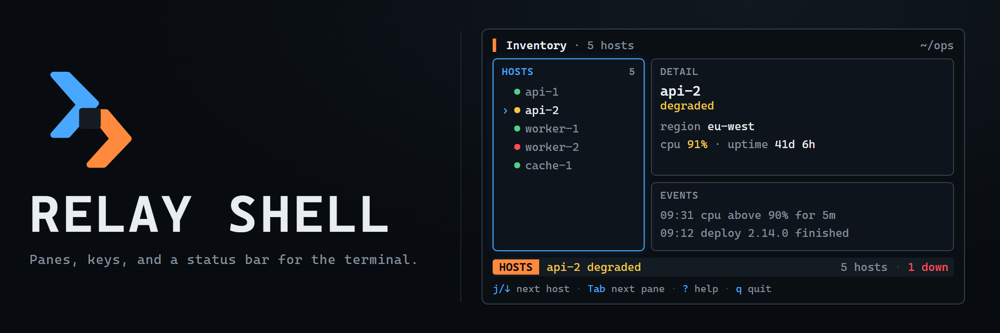

<p align="center">
  
</p>

Relay Shell is a framework for full-screen terminal applications. It provides the frame every terminal tool needs before it can show anything useful: a screen-filling layout, split panes with focus, keybindings that follow the focused pane, a keyboard reference, and a status bar.

It is built on Ink and React. An application supplies the content of each pane; Relay Shell decides where it goes, which pane receives each key, and what the status bar says.

## Try the demo

```sh
npm install
npm run demo
```

The demo opens a small host inventory with a list, a detail pane, and an events pane. It uses fixed sample data and does not contact any service. Press `Tab` to move between panes, `j` and `k` to move through hosts, `?` for the keyboard reference, and `q` to quit.

To print one frame and exit without opening the interactive screen:

```sh
npx tsx src/cli.tsx --demo --snapshot
```

## Controls

These keys come with every `Shell`. Applications add their own on top.

| Key           | Action                        |
| ------------- | ----------------------------- |
| `Tab`         | Focus the next pane           |
| `Shift+Tab`   | Focus the previous pane       |
| `?`           | Toggle the keyboard reference |
| `Esc`         | Close the keyboard reference  |
| `q`, `Ctrl+C` | Quit                          |

## Use the package

`Shell` assembles the whole frame. Children are usually a `Split` of `Pane`s, and `runShell` renders on the alternate screen so the terminal's scrollback is restored on exit.

```tsx
import {Text} from 'ink';
import {Pane, Shell, Split, runShell, usePaneKeybindings} from '@relay-cli/shell';

const HostList = () => {
  usePaneKeybindings([{keys: ['j', 'down'], description: 'Next host', run: selectNext}]);
  return <Text>api-1</Text>;
};

await runShell(
  <Shell title="Inventory" subtitle="3 hosts">
    <Split direction="row">
      <Pane id="hosts" title="Hosts" size={28}>
        <HostList />
      </Pane>
      <Pane id="detail" title="Detail">
        <Text>Select a host.</Text>
      </Pane>
    </Split>
  </Shell>,
);
```

Every part of `Shell` is also exported on its own, so an application that only needs keybindings or a status bar can adopt just that piece.

## Panes

`Split` and `Pane` divide the screen into regions. A size can be a number of cells, a percentage, or a share of the remaining space, and splits nest. The focused pane draws its border in the focus color, and `usePaneKeybindings` registers keys that only that pane receives.

## Keybindings

Components declare the keys they handle with `useKeybindings`, and Relay Shell routes each key press to exactly one of them. Overlays sit above panes and panes sit above application-wide keys, so the same key can mean different things in different panes. The keyboard reference and the hints row are generated from the same declarations.

## Status bar

Components publish short segments to the status bar with `useStatusSegment`, and any component can show a notice such as "Saved" with `useNotify`. A notice replaces the left side briefly, and then the segments return.

## Documentation

- [Package API](./docs/api.md)
- [Architecture](./docs/architecture.md)
- [Panes and focus](./docs/panes.md)
- [Keybindings](./docs/keyboard.md)
- [Status bar](./docs/status-bar.md)

## Scope

This release covers the application frame: layout, focus, keybindings, help, and the status bar. Tables, charts, forms, and log views belong in the packages that build on it, such as Relay Dash.

## Development

```sh
npm install
npm run check
```

`npm run check` verifies formatting, linting, strict types, tests, and the distributable package. Relay Shell requires Node.js 22 or newer.

## License

MIT
